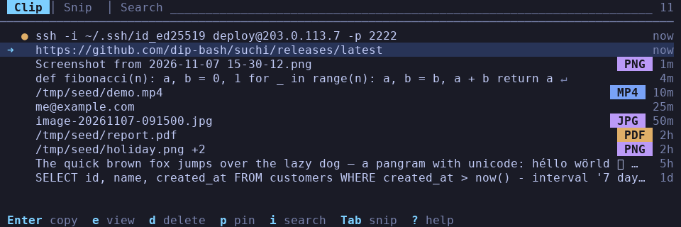
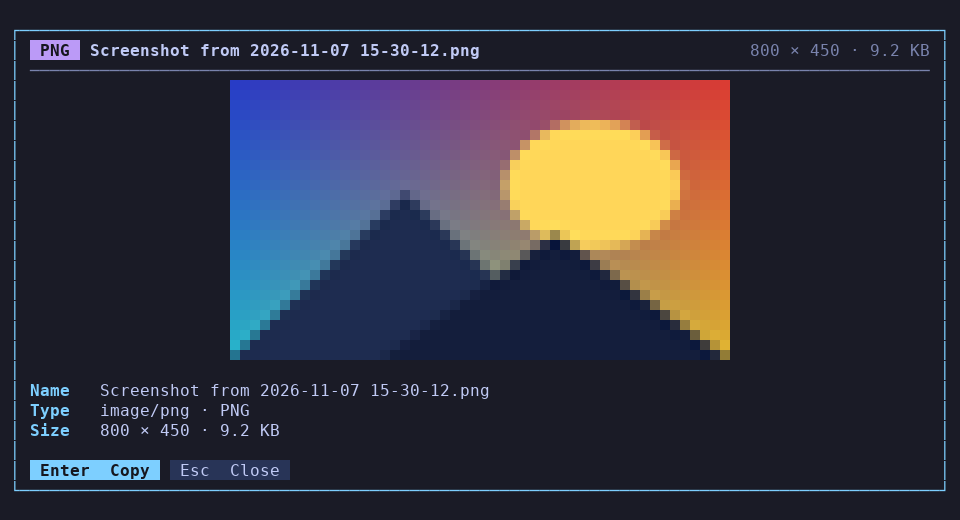
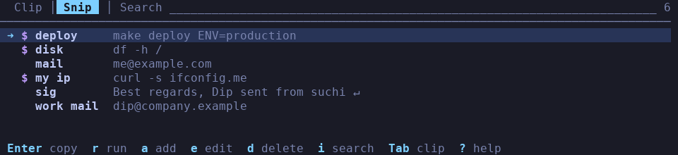

# suchi

Clipboard history and snippets for the terminal — on **Wayland**, **X11** and plain **TTYs**.



- **Clip** tab: everything you copy — text, **images** and **copied files** — searchable, pinnable, one key (or click) to copy it back.
- **Snip** tab: named snippets (a text expander): your email address, a long `ssh` line, a signature. A snippet can also be a **shell command** you run from the list.
- Preview images right in the terminal (kitty, iTerm2, sixel, or colour block art everywhere else).
- One static binary, SQLite storage, mouse support, no config file.



## Install

```sh
curl -sSL https://raw.githubusercontent.com/dip-bash/suchi/main/install.sh | bash
```

Downloads the right binary for your CPU (x86-64, ARM64, ARMv7, x86), verifies its checksum and installs it to
`~/.local/bin` (no root needed; `/usr/local/bin` as root, `$PREFIX/bin` on Termux). It also drops a systemd user
unit in place if you have systemd. Options go after `bash -s --`:

```sh
curl -sSL https://raw.githubusercontent.com/dip-bash/suchi/main/install.sh | bash -s -- --version 0.5.0 --dir ~/bin
```

Remove it again (your history and snippets are kept unless you add `--purge`):

```sh
curl -sSL https://raw.githubusercontent.com/dip-bash/suchi/main/uninstall.sh | bash
```

On **X11** you also need `xclip` (or `xsel`); Wayland needs nothing extra.

### Build from source

```sh
go mod tidy                    # once: fetches dependencies, writes go.sum
make build                     # -> suchi
make cross-build VERSION=0.5.0 # -> dist/suchi-linux-x86_64 dist/suchi-linux-aarch64
make test
```

### Publishing a release

There is no CI. Tag and push manually, then build the binaries yourself:

```sh
git tag v0.5.0 && git push origin v0.5.0
make cross-build VERSION=0.5.0
```

## Use

```sh
suchi daemon        # start the background watcher (records every copy)
suchi               # open the interface
suchi stop          # stop the watcher
suchi status        # what is running, which backend, where the database is
```

**One window at a time:** opening a new `suchi` closes the one that is already open, so a key binding such as
`footclient -W 80x30 suchi` never piles up windows. (An open window that is busy running a command snippet closes
when the command finishes.) Use `suchi --allow-multiple` to opt out.

Start the watcher at every login with `systemctl --user enable --now suchi` (the installer sets the unit up), or add
`suchi daemon` to your session's autostart.

### Keys

| Key | Action |
|---|---|
| `Tab` | switch **Clip** ⇄ **Snip** |
| `j` `k` `↑` `↓` | move (`PgUp`/`PgDn`/`Home`/`End` also work) |
| `i` | search (`Esc` leaves it) · `f` toggles fuzzy matching |
| `Enter` | copy the highlighted entry **and close** |
| `d` | delete (snippets: press twice) |
| `?` | help · `Esc` closes a popup, or quits |

**Clip tab:** `e` opens the entry (read-only) · `p` pins it to the top.
**Snip tab:** `a` adds a snippet · `e` edits it · `r` runs a command snippet.

The `e` popup scrolls with `j`/`k`/`↑`/`↓`/`PgUp`/`PgDn` or the mouse wheel; `Enter` copies and closes suchi, `Esc` closes the popup.

### Mouse

| Do | Result |
|---|---|
| click **Clip** / **Snip** | switch tab |
| double-click the **Search** field | start typing a search |
| click a row | copy it and close (a *command* snippet runs instead) |
| right-click a row | same as `e` |
| wheel | scroll the list or the popup |
| click `Copy` / `Close`, or outside the popup | copy / close |

(Terminals select text with `Shift`+drag while an app uses the mouse.)

## Images and files

suchi records what is on the clipboard, not only text:

- **Images** (screenshots, "copy image" in a browser) are stored in the database and shown as a generated file name
  like `image-20261107-153012.png`.
- **Copied files** (Ctrl+C in a file manager) are stored as paths and shown by name or path.
- A coloured **type badge** at the right of the row says what it is: `PNG`, `JPG`, `MP4`, `PDF`, `ZIP`, `GO`…
  Several files show the first one plus `+2`.
- Nothing is previewed in the list. Press `e` (or right-click) for the picture and details: type, size, dimensions,
  and for files whether they still exist. Picture files copied from a file manager are previewed too.
- Pressing `Enter` puts the image (or the file list, in a form file managers understand) back on the clipboard.

Limits: images over 16 MiB are skipped (`--max-media`), and the stored images are capped at 256 MiB in total —
the oldest unpinned ones go first. Entries a password manager marks as secret are never recorded.

### How pictures are drawn

| Terminal | Protocol |
|---|---|
| kitty, Ghostty | kitty graphics |
| iTerm2, WezTerm, mintty | iTerm2 inline images |
| foot, Konsole, mlterm, Contour | sixel |
| everything else, **tmux**, SSH, Linux console | colour half-blocks ("ANSI art", like `chafa`) — works everywhere |

Detection is automatic. Force a protocol with `SUCHI_IMAGE=kitty|iterm2|sixel|blocks|none`.
Multiplexers like tmux get blocks by default because they do not pass graphics through.

## Snippets

A snippet has a **name** (names need not be unique), a **text** and a **type**:
`text` (e.g. `mail` → `me@example.com`) or `command` (e.g. `deploy` → `make deploy ENV=production`).



`Enter` copies a snippet's text. `r` (or a click) runs a command snippet in your shell, shows its output, and
returns to suchi when you press Enter. A snippet you copy never shows up in the Clip tab.

```sh
suchi get mail                    # print a snippet: ssh host "$(suchi get deploy)"
echo "some text" | suchi add      # put text in the history (works anywhere, incl. TTYs)
suchi -p                          # pick an entry in the UI, print it (images: raw bytes → redirect)
suchi clear [--all]               # delete history (pinned entries stay unless --all)
suchi import [history.json]       # import the old Python version's history
```

## How it talks to your clipboard

| Session | Watching | Copying |
|---|---|---|
| **Wayland** (sway, Hyprland, KDE Plasma, river, labwc, COSMIC…) | native protocol client, no `wl-clipboard` | native; a tiny detached helper serves the selection until something else is copied |
| **X11** and XWayland | native XFixes events (instant, no polling) | `xclip` (text, images, files) or `xsel` (text) |
| **TTY** (Linux console, SSH) | nothing to watch — feed it with `suchi add` | OSC 52 if the terminal supports it, otherwise the line is typed into your prompt (console only, single line) or printed |

**GNOME on Wayland** has no background-clipboard protocol, so suchi uses XWayland there (needs `xclip`).
`suchi status` shows what it picked.

### Pasting in a TTY

A text console has no paste buffer, so bind a key to `suchi -p`. For bash (`~/.bashrc`):

```sh
bind -x '"\C-x\C-v": __s=$(suchi -p); READLINE_LINE="${READLINE_LINE:0:READLINE_POINT}${__s}${READLINE_LINE:READLINE_POINT}"; READLINE_POINT=$((READLINE_POINT+${#__s}))'
```

## Configuration

Flags (before or after the command) and environment variables; defaults in brackets.

| Flag | Env | |
|---|---|---|
| `--db PATH` | `SUCHI_DB` | database file [`~/.local/share/suchi/suchi.db`] |
| `--limit N` | `SUCHI_LIMIT` | history size, pinned entries exempt [500] |
| `--max-size BYTES` | `SUCHI_MAX_BYTES` | skip bigger clipboard text [1 MiB] |
| `--max-media BYTES` | `SUCHI_MAX_MEDIA` | skip bigger images [16 MiB] |
| `-s, --selection` | | `clipboard` or `primary` [clipboard] |
| `--backend` | `SUCHI_BACKEND` | `auto`, `wayland`, `x11`, `tty` [auto] |
| `--allow-multiple` | | do not close an interface that is already open |
| `--ascii` | | plain ASCII UI (automatic on the Linux console / non-UTF-8 locales) |
| | `SUCHI_IMAGE` | image protocol, see above |

The daemon logs to `~/.local/state/suchi/suchi.log`. The database is created `0600` in a `0700` directory.

## Troubleshooting

- **`migration 1: ... table clips already exists`** — fixed in 0.5: the daemon and the UI starting at the same moment
  raced to create the database. Upgrading repairs an affected database in place; nothing is lost.
- **Nothing is recorded on GNOME/Wayland or X11** — install `xclip` (`sudo apt install xclip`), then `suchi stop && suchi daemon`.
- **Pictures show as colour blocks** — that is the universal fallback. Check `echo $TERM $TERM_PROGRAM` and set `SUCHI_IMAGE` if your terminal supports a graphics protocol.
- **Mouse does nothing** — your terminal or multiplexer may not forward mouse events (tmux: `set -g mouse on`).

## Code layout

```
cmd/suchi/              entry point (calls internal/cli)
internal/cli/           command line: UI, daemon, stop, status, add, get, import, clear
internal/config/        XDG paths, limits, env overrides
internal/store/         SQLite: race-safe migrations, clips (text/image/file), snippets
internal/clipboard/     backends: wayland (wire protocol), x11 (XFixes + xclip), tty (OSC 52)
internal/daemon/        watcher loop, detached start
internal/pidlock/       flock-based single-instance lock (daemon, and "newest window wins" for the UI)
internal/preview/       image decoding, kitty/iTerm2/sixel/half-block rendering, file types
internal/tui/           Bubble Tea UI: tabs, list, popup (Viewport), form, mouse (BubbleZone), springs (Harmonica)
internal/textutil/      sanitising, width-aware truncation/wrapping, matching
```

Built with [Bubble Tea](https://github.com/charmbracelet/bubbletea), [Lip Gloss](https://github.com/charmbracelet/lipgloss),
[Bubbles](https://github.com/charmbracelet/bubbles) (Viewport), [BubbleZone](https://github.com/lrstanley/bubblezone) (mouse),
[Harmonica](https://github.com/charmbracelet/harmonica) (spring animation) and [ntcharts](https://github.com/NimbleMarkets/ntcharts)
(the canvas the block-art previews are drawn on).
